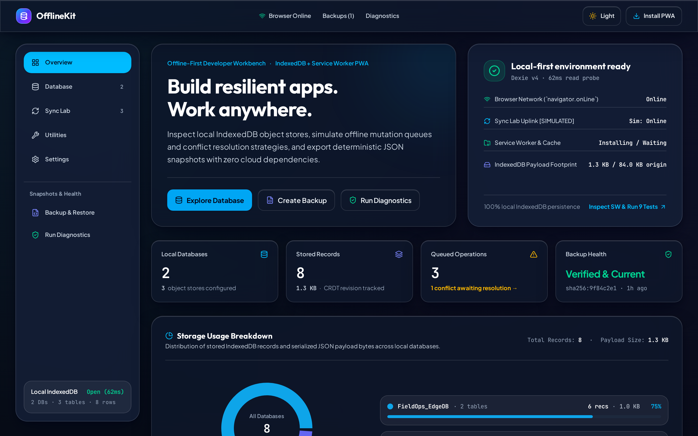
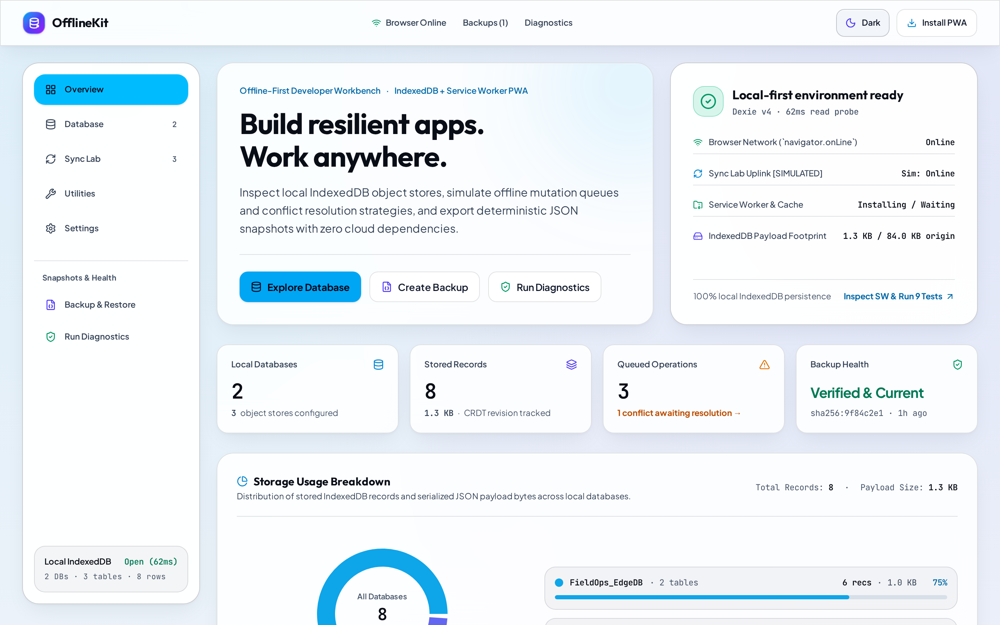
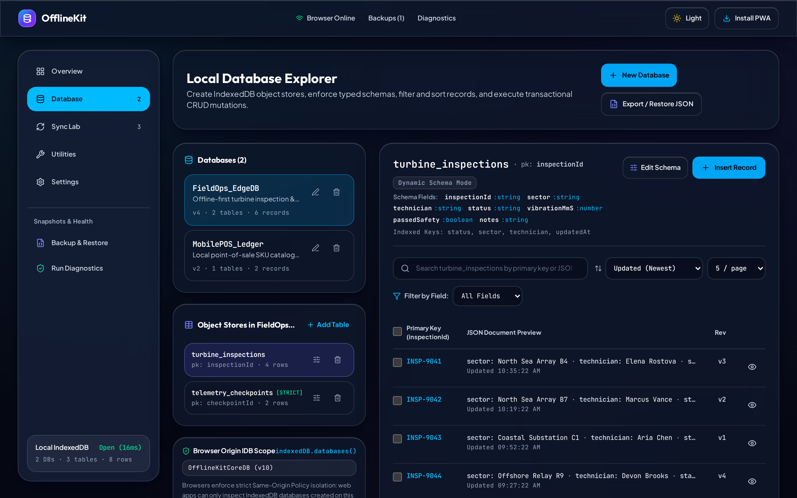
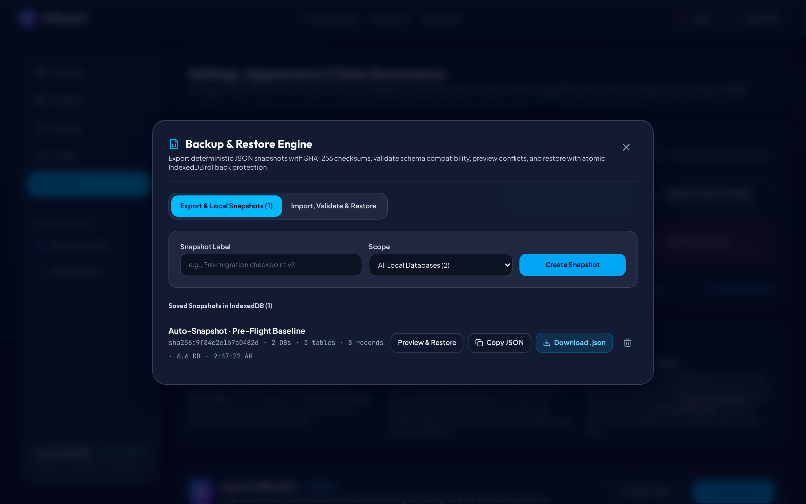
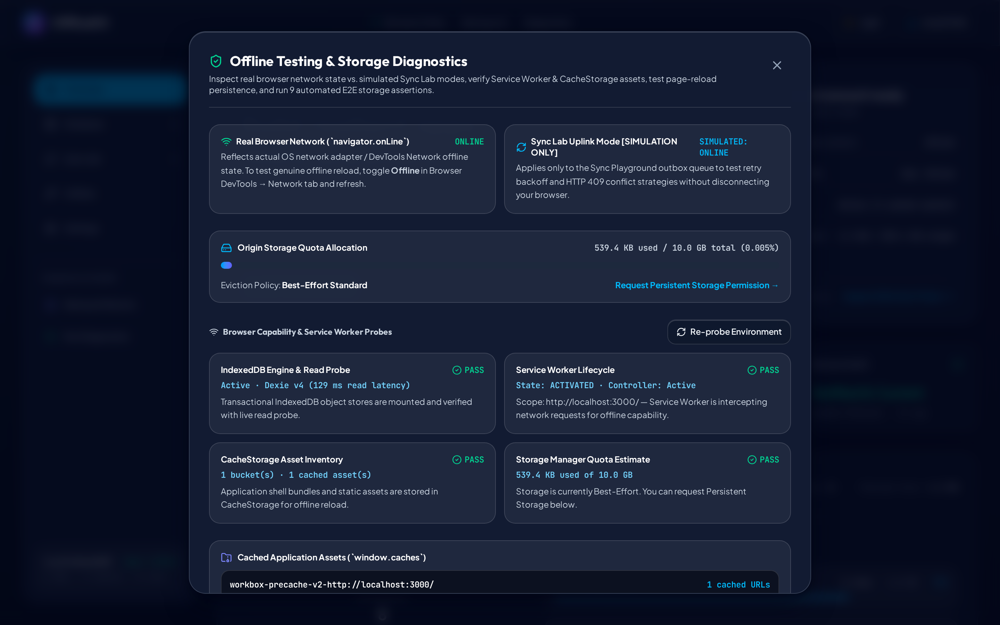
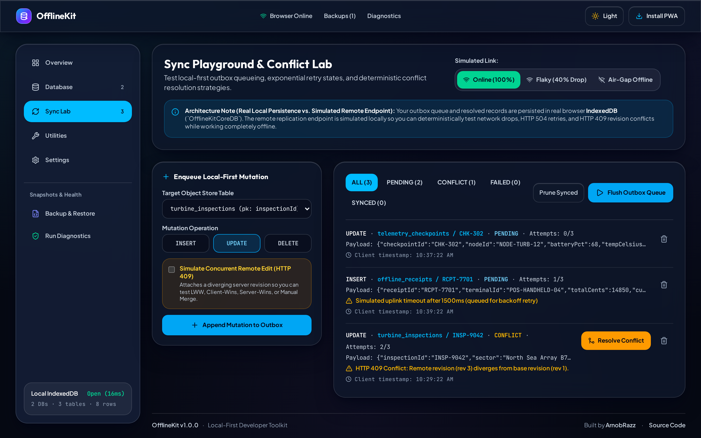
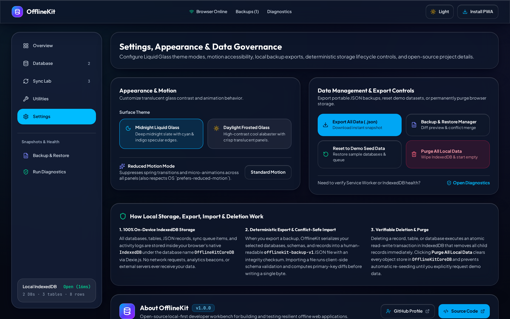

# OfflineKit — Offline-First Developer Toolkit

<p align="center">
  
</p>

<p align="center">
  <strong>Production-Grade Local-First Storage Inspector, Backup Engine & Offline Verification Workbench</strong>
</p>

<p align="center">
  <a href="https://github.com/arnob123/OpenDevKit"></a>
  <a href="https://github.com/arnob123/"></a>
  <a href="LICENSE"></a>
  
  
</p>

---

## Overview

**OfflineKit** is an open-source, self-contained developer toolkit built with **React 19, TypeScript, Vite, Tailwind CSS v4, and Dexie.js (IndexedDB)**. Designed with an **iOS 26 Liquid Glass** aesthetic and engineered to meet **WCAG AA+ contrast standards** across both **Midnight Liquid Glass (Dark)** and **Daylight Frosted Glass (Light)** themes, OfflineKit provides developers with a real-time environment to build, inspect, backup, conflict-test, and audit offline-first web applications.

Every feature runs **100% locally in your browser** using real persistent IndexedDB transactions, Web Crypto SHA-256 verification, and Workbox Service Worker caching—with **zero mandatory backend, zero API keys, and zero external telemetry**.

- **Official Repository**: [https://github.com/arnob123/OpenDevKit](https://github.com/arnob123/OpenDevKit)
- **Developer Profile**: [ArnobRazz (`https://github.com/arnob123/`)](https://github.com/arnob123/)

---

## Core Features

### 1. Real IndexedDB Database Explorer (`Dexie.js`)
- **Database & Object Store Management**: Create, inspect, edit metadata, and delete virtual databases and tables backed by persistent IndexedDB stores (`OfflineKitStorage`).
- **Typed Schema Definitions & Strict Validation**: Define typed field rules (`string`, `number`, `boolean`, `object`, `array`), required field constraints, and toggle per-table `Strict Schema Validation` to reject non-conforming payloads before write commits.
- **Dual-Mode Record Editor**: Create and update records using either a guided **Form Builder** (auto-generated from table schema fields) or a **Raw JSON Editor** with live syntax parsing and schema validation errors.
- **Query, Filter, Sort & Bulk Operations**: Full-text search across keys and JSON payloads, field-specific filtering, ascending/descending column sorting, configurable pagination (`5 / 10 / 25 / 50`), JSON document inspection, and multi-select bulk deletion.
- **Browser Origin IndexedDB Scope Inspector**: Enumerates real browser IndexedDB databases on the active origin via `indexedDB.databases()` and clearly documents browser Same-Origin Policy boundaries.

### 2. Reliable Backup & Restore Engine (`SHA-256` + Atomic Rollback)
- **Cryptographic Envelope (`offlinekit-backup-v1`)**: Exports complete or selective JSON snapshots containing `schemaVersion: 1`, ISO timestamps, entity counts, and canonical **Web Crypto SHA-256 checksums**.
- **Deep Pre-Flight Validation & Diffing**: Parses incoming backups, verifies SHA-256 integrity, detects schema version incompatibilities, flags internal duplicate IDs or orphan records, and categorizes every record as **New Addition**, **Identical**, or **Conflicting Revision**.
- **4 Conflict Resolution Strategies + Per-Record Overrides**:
  - `MERGE_SKIP_CONFLICTS` — Keep existing local records when IDs collide; insert new records only.
  - `KEEP_NEWER_TIMESTAMP` — Compare `updatedAt` timestamps and retain the newer revision.
  - `UPSERT_OVERWRITE` — Overwrite conflicting records with incoming backup values while preserving untouched local records.
  - `CLEAN_REPLACE` — Destructive full database wipe and replacement (protected by an explicit confirmation gate).
- **Pre-Restore Safety Snapshot & Atomic Rollback**: Automatically captures an in-memory safety snapshot prior to execution and runs all writes inside an atomic Dexie `rw` transaction so any failure rolls back cleanly without partial corruption.

### 3. Comprehensive Offline Testing & Diagnostics Workbench
- **9-Case In-Browser E2E Sandbox Test Runner**: Executes repeatable automated verification directly against an isolated IndexedDB store (`OfflineKitTestSandbox_DB`) covering:
  1. IndexedDB Record Creation & Persistence
  2. Record Update, Revision Increment & Schema Validation
  3. Record Deletion & Referential Cleanup
  4. Page Reload Persistence Checkpoint
  5. Backup Export & SHA-256 Checksum Integrity
  6. Malformed JSON & Checksum Tamper Rejection
  7. Conflict Resolution Strategies (`MERGE`, `NEWER_TIMESTAMP`, `OVERWRITE`)
  8. Transactional Rollback on Storage Write Failure
  9. Offline Outbox Queue & Reconnect Replay Simulation
- **Service Worker & CacheStorage Asset Inspector**: Inspects real `navigator.serviceWorker` controller state, `StorageManager` quota usage, and cached URLs inside browser `CacheStorage`.
- **Page Reload Persistence Marker**: Writes a cryptographic checkpoint marker to IndexedDB and verifies its survival across real browser refreshes (`Cmd/Ctrl + R`), proving physical disk persistence.
- **Real vs. Simulated Network Transparency**: Explicitly distinguishes real browser hardware connectivity (`navigator.onLine`) from the **Sync Lab's** simulated network modes (`Online / Slow 3G / Offline / Flaky 40%`), which are clearly labeled `[SIMULATION ONLY]`.

### 4. Sync Lab & Developer Utilities
- **Local-First Outbox Queue**: Enqueue `CREATE`, `UPDATE`, and `DELETE` mutations while offline, inspect retry backoff counters, simulate 409 version conflicts, and resolve collisions (`Local Wins`, `Remote Wins`, or `Manual JSON Merge`).
- **Offline Developer Utilities**: Base64 Codec, JWT Header/Payload Inspector, SHA-256 / SHA-512 Hash Generator, UUID v4 Batch Generator, and JSON Formatter & Diff Checker.

---

## Architecture Overview

```text
+-----------------------------------------------------------------------------------+
|                        OfflineKit UI Layer (React 19 + TypeScript)                |
|  +-----------------+ +------------------+ +----------------+ +-----------------+  |
|  |  OverviewView   | | DatabaseExplorer | |  SyncLabView   | | Utilities /     |  |
|  |  (Live Health)  | | (CRUD + Schema)  | | [SIMULATION]   | | Settings & About|  |
|  +--------+--------+ +--------+---------+ +-------+--------+ +--------+--------+  |
|           |                   |                   |                   |           |
|  +--------v-------------------v-------------------v-------------------v--------+  |
|  |         BackupRestoreModal (SHA-256 Diffing) & DiagnosticsModal (E2E)       |  |
+-----------+-----------------------------------+-----------------------+-----------+
            |                                   |                       |
            v                                   v                       v
+-----------------------+           +-----------------------+ +---------------------+
|   Dexie.js Engine     |           |  Backup & Restore     | | In-Browser Sandbox  |
|  (src/db/offlineDb.ts)|           | (src/utils/backup...) | | (inBrowserTestSuite)|
|  - databases          |           |  - Canonical SHA-256  | | - 9 Isolated Tests  |
|  - tables (+schema)   |           |  - Conflict Diffing   | | - Reload Marker     |
|  - records            |           |  - Atomic Rollback    | | - CacheStorage Scan |
|  - syncQueue          |           +-----------+-----------+ +----------+----------+
|  - activityLogs       |                       |                        |
+-----------+-----------+                       |                        |
            |                                   |                        |
            +-----------------------------------+------------------------+
                                                |
                                                v
+-----------------------------------------------------------------------------------+
|                Browser Native Web APIs (100% Local, Zero Backend)                 |
|  [IndexedDB: OfflineKitStorage]  [Web Crypto API: SHA-256]  [ServiceWorker + PWA] |
+-----------------------------------------------------------------------------------+
```

---

## Tech Stack

| Layer | Technology | Purpose |
| :--- | :--- | :--- |
| **Frontend Framework** | React 19 + TypeScript 5.8+ | Component architecture & strict static typing |
| **Build Tooling** | Vite 6 + `@tailwindcss/vite` | Fast ES module bundling & Tailwind CSS v4 styling |
| **Local Persistence** | Dexie.js 4 (`IndexedDB`) | Transactional client-side database & schema indexing |
| **Offline PWA** | `vite-plugin-pwa` (Workbox) | Service worker registration, precaching & offline shell |
| **Data Visualization** | Recharts 3 | Storage usage donut breakdown & telemetry charts |
| **Motion & Icons** | Motion (`framer-motion`) + Lucide React | Tactile spatial transitions (`prefers-reduced-motion` aware) |
| **Automated Testing** | Vitest + `fake-indexeddb` | Headless unit/integration tests + in-browser E2E runner |

---

## Prerequisites & Quick Start

### Prerequisites
- **Node.js**: `>= 20.0.0` (LTS recommended)
- **npm**: `>= 10.0.0`
- **Modern Browser**: Chrome, Edge, Firefox, or Safari with `IndexedDB`, `ServiceWorker`, and `crypto.subtle` enabled.

### Installation

```bash
# 1. Clone the official repository
git clone https://github.com/arnob123/OpenDevKit.git
cd OpenDevKit

# 2. Install dependencies
npm install

# 3. Start the local development server on port 3000
npm run dev
```

Open `http://localhost:3000` in your browser.

---

## Development, Testing & Build Commands

| Command | Description |
| :--- | :--- |
| `npm run dev` | Starts the Vite development server on `http://localhost:3000` |
| `npm run lint` | Runs TypeScript compiler verification (`tsc --noEmit`) |
| `npm test` | Runs the automated Vitest unit & integration test suite (`src/tests/storage.test.ts`) |
| `npm run test:watch` | Runs Vitest in interactive watch mode |
| `npm run build` | Compiles production bundle and generates the Workbox Service Worker (`dist/`) |
| `npm run preview` | Serves the production `dist/` build locally to test Service Worker offline reload |

---

## Usage Walkthrough

### 1. Creating & Validating Local IndexedDB Records
1. Navigate to **Database Explorer** (`Cmd/Ctrl + 2`).
2. Select a database (e.g., `OfflineKit_Core`) and table (e.g., `users`), or click **New Table** to define custom typed schema fields (`string`, `number`, `boolean`, `object`, `array`) and toggle **Strict Schema Validation**.
3. Click **Insert Record** to open the dual-mode Record Editor:
   - Use **Form Builder** for guided typed inputs, or switch to **Raw JSON** for direct payload editing.
4. Search across keys/values, filter by specific JSON properties, sort columns, or select multiple rows for **Bulk Delete**.

### 2. Exporting & Restoring Verified Backups
1. Click **Backup** in the top navigation bar.
2. In the **Export Snapshot** tab, choose **Full Snapshot** or select specific databases, then click **Download Verified Backup (`.json`)**.
3. Switch to **Import & Restore** and upload any `.json` backup file:
   - OfflineKit verifies the **SHA-256 checksum**, checks `schemaVersion`, and displays a complete diff (**New**, **Identical**, **Conflicts**, and **Warnings**).
   - Select one of the 4 conflict resolution strategies (or set per-record overrides) and execute an atomic, rollback-protected restore.

### 3. Verifying Real Offline Capability vs. Simulated Network Conditions
1. Open the **Diagnostics & E2E Test Suite** modal (shield icon in the header or from the **Overview** dashboard).
2. Click **Write Reload Marker**, then press `Cmd/Ctrl + R` to reload the browser tab and confirm that the marker persists on physical disk.
3. Click **Run All 9 Tests** to execute the automated in-browser IndexedDB + Backup + Rollback verification suite.
4. To test true browser-level offline mode after running `npm run build && npm run preview`, open Browser DevTools → **Network** → select **Offline**, and reload the page.

---

## Browser Security Boundaries & Limitations

OfflineKit is designed around strict engineering honesty:

1. **Same-Origin Policy for IndexedDB**: Browser security models isolate IndexedDB per origin (`protocol + hostname + port`). OfflineKit can inspect and enumerate other IndexedDB databases that share the **same origin** via `indexedDB.databases()`, but no web application can access IndexedDB stores belonging to external domains.
2. **Real Hardware Network vs. Sync Lab Simulation**:
   - The top header badge reflects your **real browser network state** (`navigator.onLine`).
   - The **Sync Lab** network switcher (`Online`, `Slow 3G`, `Offline`, `Flaky 40%`) is an application-level **outbox simulator** (`[SIMULATION ONLY]`) for testing queue backoff and conflict resolution without disconnecting your machine's Wi-Fi.
3. **Unencrypted JSON Backups**: Exported `.json` backup files contain plaintext data signed with a SHA-256 integrity hash. Do not commit exported backups containing sensitive tokens or PII to public repositories.

---

## Screenshots & Visual Documentation

| Midnight Liquid Glass (Dark Mode) | Daylight Frosted Glass (Light Mode) |
| :---: | :---: |
|  |  |
| **Overview Dashboard (Dark)** — Live IndexedDB quota telemetry, Service Worker status, and Recharts storage breakdown. | **Overview Dashboard (Light)** — High-contrast WCAG AA+ Daylight Frosted Glass theme. |

| Local Database Explorer (`Dexie.js`) | Verified Backup & Restore (`SHA-256`) |
| :---: | :---: |
|  |  |
| **Database Explorer** — Real IndexedDB CRUD, typed schema editor, dual Form/JSON editor, and Origin IDB Scope inspector. | **Backup & Restore Engine** — Canonical SHA-256 verification, conflict diffing, and atomic rollback protection. |

| Offline Testing & E2E Diagnostics | Sync Lab Outbox Playground |
| :---: | :---: |
|  |  |
| **Diagnostics & 9-Case E2E Suite** — Isolated IndexedDB sandbox runner, reload persistence checkpoint, and CacheStorage inspector. | **Sync Lab (`[SIMULATION ONLY]`)** — Local-first write queue, retry backoff states, and 409 conflict resolution. |

### Settings & About (Developer Attribution)


---

## GitHub Pages Deployment

OfflineKit includes an automated GitHub Actions workflow (`.github/workflows/deploy-pages.yml`) pre-configured for deployment to `https://arnob123.github.io/OpenDevKit/`:

1. Push the repository to the `main` branch on `https://github.com/arnob123/OpenDevKit`.
2. In your GitHub repository, navigate to **Settings → Pages**.
3. Under **Build and deployment → Source**, select **GitHub Actions**.
4. The `Deploy to GitHub Pages` workflow automatically builds with `GITHUB_PAGES=true` (setting the Vite base path and PWA manifest scope to `/OpenDevKit/`) and publishes the production artifact.

---

## Troubleshooting

| Symptom | Cause | Resolution |
| :--- | :--- | :--- |
| **Service Worker shows `Not Registered (Dev Mode)`** | Vite dev server serves unbundled ES modules by default | Run `npm run build && npm run preview` to test the production Workbox service worker (`sw.js`). |
| **`QuotaExceededError` during import** | Browser storage quota exhausted or private browsing limit reached | Free up origin space via **Settings → Factory Reset** or export and prune unused tables. |
| **Checksum mismatch warning on import** | The `.json` backup file was manually edited after export | Review the pre-flight diff carefully before proceeding, or re-export a clean snapshot. |

---

## Roadmap

- [x] Real Dexie.js IndexedDB CRUD with typed schema validation & dual Form/JSON editor
- [x] SHA-256 verified JSON Backup & Restore with 4 conflict strategies & atomic rollback
- [x] 9-case in-browser E2E test suite + headless Vitest unit/integration suite
- [x] WCAG AA+ dual theme system (`Midnight Liquid Glass` & `Daylight Frosted Glass`)
- [ ] Optional AES-GCM passphrase encryption for exported backup archives
- [ ] CSV and SQLite (`.wasm`) import/export adapters
- [ ] CRDT state-vector visualizer in the Sync Lab

---

## Contributing & Security

Contributions, bug reports, and feature requests are welcome! Please review:
- [Contributing Guidelines (`CONTRIBUTING.md`)](CONTRIBUTING.md)
- [Code of Conduct (`CODE_OF_CONDUCT.md`)](CODE_OF_CONDUCT.md)
- [Security Policy (`SECURITY.md`)](SECURITY.md)
- [Changelog (`CHANGELOG.md`)](CHANGELOG.md)

---

## License & Credits

- **License**: Released under the [MIT License](LICENSE) (`Copyright (c) 2026 Gameofbtc (ArnobRazz)`).
- **Author & Maintainer**: Developed by **ArnobRazz**
  - GitHub Profile: [https://github.com/arnob123/](https://github.com/arnob123/)
  - Official Repository: [https://github.com/arnob123/OpenDevKit](https://github.com/arnob123/OpenDevKit)
